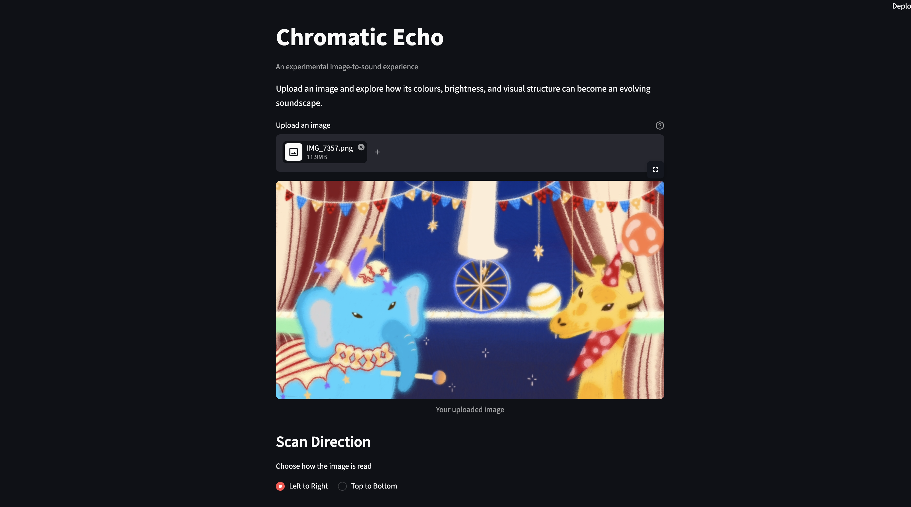
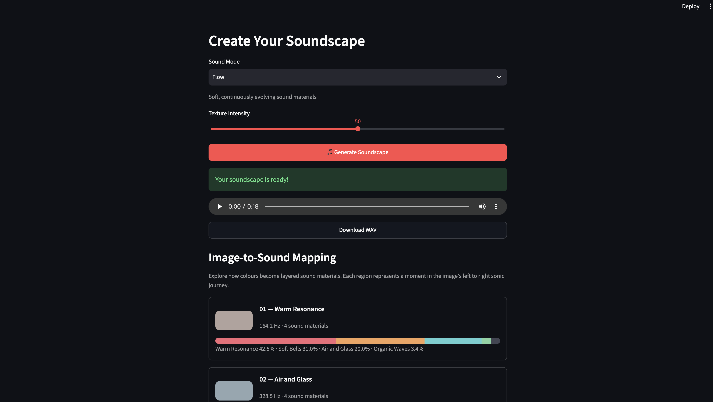

# Chromatic Echo — Image to Sound

**An experimental interactive artwork that transforms images into evolving soundscapes.**

Chromatic Echo explores a simple question:

*What if we could listen to an image instead of only looking at it?*

By analysing the colours, brightness, saturation, and spatial composition of an uploaded image, the application generates an original ambient soundscape using procedural audio synthesis.

The project was developed for **SD5913 — Programming for Artists and Designers** at The Hong Kong Polytechnic University.

## 1. Project Overview

Chromatic Echo investigates the relationship between visual and auditory perception.

Rather than generating conventional music through an AI music model, the application translates visual characteristics into different synthesized sound materials.

Users can experiment with scanning directions, sound modes, and texture intensity to discover different interpretations of the same image.

There is no single correct sound for an image. The experience encourages exploration and personal interpretation.

## 2. Features

- **Image Upload:** Supports JPG, JPEG, PNG, and WEBP images, with a maximum file size of 25 MB.
- **Image Analysis:** Calculates brightness, saturation, hue, colour distribution, and colour diversity.
- **Eight Colour Families:** Red, Orange, Yellow, Green, Cyan, Blue, Purple, and Pink.
- **Scan Direction:** Choose Left to Right or Top to Bottom to change how the image is interpreted.
- **Colour Journey:** Visualizes the colour composition of eight sequential image regions.
- **Three Sound Modes:** Echo, Flow, and Pulse.
- **Texture Intensity:** Adjusts the strength of the synthesized sound textures.
- **Procedural Audio Generation:** Creates an approximately 18-second WAV soundscape.
- **Audio Playback and Download:** Listen directly in the browser or download the generated WAV file.
- **Image-to-Sound Mapping:** Displays the sound materials and colour contributions associated with each image region.
- **User Guidance:** Includes a colour legend and explanations of how visual information contributes to sound.

## 3. How to Run

### Requirements

- Python
- uv (Python package and project manager)
- A modern web browser

### Step 1 — Download the Project

Clone the GitHub repository:

```bash
git clone https://github.com/SeanGuo0326/chromatic-echo.git
cd chromatic-echo
```

Alternatively, download the repository as a ZIP file and extract it.

### Step 2 — Install Dependencies

The project uses `uv` to manage Python dependencies.

From the project directory, run:

```bash
uv sync
```

This installs the dependencies specified by the project configuration and lockfile.

### Step 3 — Start the Application

Run:

```bash
uv run streamlit run app.py
```

Streamlit will display a local URL, usually:

```text
http://localhost:8501
```

Open this address in a web browser.

To stop the application, press `Control + C` in the terminal.

## 4. How to Use

1. **Upload an image** using the file uploader.
2. **Explore Image Analysis** to see the image's brightness, saturation, hue, and colour distribution.
3. **Choose a Scan Direction:** Left to Right or Top to Bottom.
4. **Read the Colour Journey:** Each horizontal bar represents one of eight image regions. The coloured segments indicate the proportions of different colour families.
5. **Choose a Sound Mode:** Echo, Flow, or Pulse.
6. **Adjust Texture Intensity** to change the strength of the sound textures.
7. **Click Generate Soundscape** to create audio from the image.
8. **Listen to the result** using the built-in player.
9. **Explore Image-to-Sound Mapping** to understand how different colours contribute to the sound.
10. **Download the WAV file** or change the settings and generate another interpretation.

Try using the same image with different scanning directions to compare how the soundscape evolves.

## 5. Image-to-Sound Mapping

The application analyses an image using eight colour families.

Each colour family has an artistic sound identity:

| Colour | Sound Material |
|---|---|
| Red | Warm Resonance |
| Orange | Soft Bells |
| Yellow | Golden Chimes |
| Green | Organic Waves |
| Cyan | Air and Glass |
| Blue | Deep Water |
| Purple | Crystal Dust |
| Pink | Dream Sparkles |

These mappings are creative decisions rather than scientific claims about colour frequencies.

The application uses regional colour distributions to combine multiple sound materials. Brightness and other image characteristics also influence the synthesis.

The selected scanning direction determines the order in which the eight regions contribute to the evolving soundscape.

### Sound Modes

**Echo:** Spacious echoes and fading colour traces.

**Flow:** Soft, continuously evolving sound materials.

**Pulse:** Experimental rhythmic colour particles.

All sound is synthesized programmatically using Python and NumPy.

## 6. Technical Approach

Chromatic Echo uses:

- **Python** for application logic.
- **Streamlit** for the interactive web interface.
- **Pillow** for image loading and processing.
- **NumPy** for numerical image analysis and sound synthesis.
- **Python's wave library** for WAV audio output.
- **uv** for dependency management.

The sound is generated locally from image-derived parameters. The application does not require an external music-generation API.

## 7. Project Structure

```text
chromatic-echo/
├── app.py
├── image_analysis.py
├── sound_generator.py
├── README.md
├── PROCESS.md
├── pyproject.toml
├── uv.lock
└── .gitignore
```

**app.py** — Streamlit interface, user controls, visualizations, and audio playback.

**image_analysis.py** — Image validation, colour analysis, regional distributions, and diversity calculations.

**sound_generator.py** — Procedural audio synthesis, sound modes, and image-to-sound mapping.

**PROCESS.md** — Development history, experiments, problems, design decisions, AI assistance, and user testing.

**pyproject.toml / uv.lock** — Project configuration and dependency management.

## 8. Testing and Iteration

Chromatic Echo was developed through several iterations.

Early testing revealed that different images could produce similar, repetitive sounds. This led to improvements in colour analysis and the introduction of multiple synthesized sound materials.

Further testing showed that alternative scanning directions changed the image's regional colour distributions. The sound engine was subsequently revised to make those changes more audible.

A usability test with a fellow student provided additional feedback:

- The image and sound felt connected through their overall style and atmosphere.
- The difference between the two scanning directions was audible.
- The colour-block visualization was initially confusing.
- More instrumental variety was suggested as a possible improvement.

In response, I added clearer explanations, a colour legend, and an expandable guide to the Colour Journey section.

The full development process is documented in [PROCESS.md](PROCESS.md).

## 9. AI Assistance and Credits

**Project concept, artistic direction, testing, and design decisions:** Guo Zijun (Sean).

ChatGPT was used as a development assistant to help explain programming concepts, draft and revise Python code, troubleshoot errors, and organize documentation.

The generated code was tested locally, and design decisions were made in response to the observed behaviour of the application and the intended artistic experience.

**The audio is not generated by an AI music-generation model.** It is synthesized procedurally from the uploaded image's analysed visual characteristics.

### Libraries and Tools

Python, Streamlit, Pillow, NumPy, uv, and Python's standard-library wave module.

## 10. Screenshots

### Main Interface


### Sound Generation and Mapping

## 11. Future Development

Possible future improvements include:

- A wider variety of instrumental and acoustic sound textures.
- Additional scanning patterns.
- More detailed control over the relationship between colour and sound.
- Further usability testing with different participants.

Chromatic Echo is an exploration of how interactive systems can transform visual information into new sensory experiences.